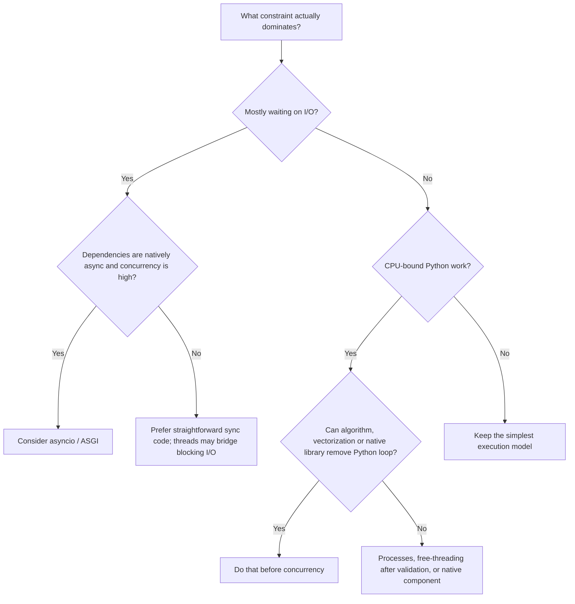

# Modern Python Software Engineering in 2026: Research Foundation for a Senior Python Engineer AI Skill

> Historical input retained for provenance. This is not an active instruction or a current factual baseline; use SOURCE_POLICY.md and the current claim registers.

## Executive summary

The top-level request describes the topic as unspecified, but the uploaded research brief removes that ambiguity: the actual subject is **modern Python software engineering as of 2026**, researched as the factual and judgmental foundation for a future Senior Python Engineer AI Skill. The brief explicitly requires separation of language guarantees from CPython behavior, framework conventions, ecosystem practices, legacy advice, and emerging capabilities; it also asks for architecture, concurrency, typing, web, data, AI/ML, testing, security, packaging, deployment, anti-patterns, and senior-level decision frameworks. fileciteturn0file0

As of **September 29, 2026**, the safe production baseline is Python **3.14**; the official documentation is at 3.14.7. Python 3.15 is still in release-candidate status immediately before its scheduled final release, so 3.15-only behavior should not yet be encoded as an established production assumption. citeturn18search16turn1search3turn1search8

The most important conclusion is that senior Python engineering is not primarily about knowing more syntax. It is about preserving correct boundaries between layers of semantics:

| Layer | What a senior engineer should assume |
|---|---|
| Python language | Data model, object/reference semantics, import semantics, exceptions, descriptors, MRO, protocols, syntax and documented guarantees |
| CPython | Reference counting, cyclic GC implementation, the conventional GIL build, free-threaded build, interpreter/JIT implementation details |
| Typing | A gradual static analysis system; annotations normally do **not** enforce runtime validity |
| Frameworks | Local conventions and lifecycle models, not universal Python architecture |
| Packaging | Increasingly standardized metadata/build/lock interchange, but multiple competing workflow tools |
| Production | Correctness depends heavily on resource ownership, transaction boundaries, cancellation, timeouts, deployment topology and observability |
| AI/ML | Python commonly orchestrates computation whose expensive kernels execute in C/C++/CUDA/XLA or other native runtimes |

Python's strategic advantage remains unusually broad interoperability and developer productivity, particularly around AI/ML, scientific computing, data work, automation and application orchestration. PyTorch itself notes that computationally expensive operations in its Python interface generally execute in C++, while JAX traces Python-expressed array programs into XLA-compiled computations. This explains why "Python is slow" is simultaneously true for tight interpreter-bound loops and misleading for much of contemporary ML/scientific Python. citeturn13search0turn13search1turn13search2

A second major conclusion is that the concurrency story has materially changed. Conventional CPython still normally uses a GIL that prevents multiple threads from simultaneously executing Python bytecode, although blocking I/O commonly releases it. Python 3.14, however, makes the free-threaded build officially supported under PEP 779; this should be classified as **supported but still ecosystem-maturing**, not as evidence that all Python applications should immediately become multithreaded. Multiple interpreters are also becoming an explicit concurrency mechanism. The optional CPython JIT remains a different, more experimental optimization path. citeturn0search0turn0search2turn0search5turn6search2turn0search3

The foundation for a Senior Python Engineer Skill should therefore emphasize **conditional judgment rather than slogans**: prefer explicit resource ownership; choose async only when concurrency and dependency behavior justify it; keep database transaction ownership visible; optimize measured bottlenecks; treat external data as untrusted; keep static typing proportional to the value it provides; avoid abstractions whose maintenance cost exceeds the duplication or coupling they remove; and distinguish convenient Python orchestration from workloads that belong in native, accelerator, database, or distributed-compute layers. Those principles are consistent with the language's own emphasis on readability and practicality rather than purity. citeturn18search0turn18search1

## Scope, methodology, and evidence status

This investigation prioritizes official Python documentation and PEPs, PyPA specifications, framework/library documentation, and original project documentation. Ecosystem adoption evidence is treated separately from technical correctness: popularity can establish that Python is widely used for a domain, but cannot establish that a particular architecture is desirable. The Python Developers Survey and GitHub's ecosystem data, for example, support Python's central position in data/AI work, while the architectural conclusions in this report are grounded primarily in Python, PyPA and framework specifications. citeturn2search9turn2search5

The following status taxonomy is important because 2026-era Python mixes mature mechanisms with rapidly changing interpreter work:

| Status in September 2026 | Examples | Engineering interpretation |
|---|---|---|
| **Stable / ordinary production practice** | Python 3.14; normal GIL build; `asyncio`; threads/processes; `pyproject.toml`; ASGI/WSGI; gradual typing | Safe default assumptions, subject to application requirements |
| **Stable but comparatively new** | Free-threaded 3.14 builds; multiple-interpreter APIs; standardized `pylock.toml` | Viable where benefits justify compatibility/testing work |
| **Experimental / opt-in** | CPython 3.14 JIT | Benchmark before adoption; do not design architecture around assumed speedups |
| **Pre-release on research date** | Python 3.15 | Study direction, but do not present as current stable behavior |
| **Speculative** | Eventual universal no-GIL ecosystem, broad automatic JIT gains, a single dominant packaging frontend | Do not encode as fact |

PEP 779 explicitly moves free threading into a supported phase while leaving the eventual decision about making it the default to future evaluation. CPython's own free-threading documentation warns that incompatible native extensions can still cause the GIL to be re-enabled. Python 3.14's JIT documentation likewise characterizes the JIT as experimental. citeturn0search5turn0search2turn0search3

The largest evidence gap is not language semantics but **production comparative data**. There is no authoritative dataset capable of answering universally whether FastAPI beats Django, whether repositories improve maintainability, whether microservices outperform modular monoliths organizationally, or whether strict typing produces a net benefit in every Python codebase. These are context-dependent engineering choices. Future quantitative enrichment would benefit from PyPI download datasets, public GitHub dependency graphs, Python performance benchmark archives, package vulnerability data, production incident datasets, framework benchmark suites that include realistic I/O/database workloads, and organizational studies linking defect/lead-time metrics to typing and architectural practices. Such datasets should be used cautiously because downloads, stars and benchmark throughput are poor proxies for architectural quality.

## Technical findings across the Python stack

**Language semantics.** Python variables are names bound to objects, not typed storage slots in the C/Java sense. Every object has identity, type and value; mutability belongs to the object's type. `is` tests identity while `==` invokes equality semantics. Scope resolution, closures, descriptors, properties, decorators, iteration, generators, context management and dunder methods are pieces of the same object/data model rather than disconnected "advanced features." Descriptor lookup, for example, underlies bound methods and properties; C3 method-resolution order makes cooperative multiple inheritance deterministic but does not make complicated inheritance hierarchies easy to understand. citeturn4view0turn18search2turn18search14

Engineers must particularly avoid converting **CPython behavior into language guarantees**. CPython uses reference counting plus cyclic garbage collection, but Python deliberately does not promise deterministic garbage collection across implementations. Consequently, files, transactions, sockets and locks should be released through explicit lifecycle mechanisms—usually context managers—rather than by assuming object destruction will happen immediately. Weak references are useful for non-owning caches/registries, but they do not replace explicit ownership. citeturn18search34turn4view3turn18search2

Imports execute module top-level code and cache module objects; they are therefore part of application initialization and dependency architecture, not merely textual inclusion. Circular imports commonly expose poor dependency direction or excessive import-time work. Import-time network connections, mutable global initialization and environment-dependent side effects also make startup, testing and multiprocessing less predictable. citeturn4view2

**Typing.** Modern Python has a formal gradual type system. `Protocol` provides structural typing; `TypeVar` and modern type-parameter syntax support generics; `ParamSpec` preserves callable parameter signatures; `TypedDict`, `Literal`, `Annotated`, `Self`, `NewType`, overloads and narrowing constructs such as `TypeGuard`/`TypeIs` make increasingly precise APIs possible. PEP 695 introduced native type-parameter syntax, while PEP 742 added `TypeIs`. The crucial boundary is that ordinary annotations are metadata for static tooling and related consumers, **not automatic runtime validation**. citeturn16search9turn16search20turn5search5turn5search13turn16search31

Strong teams therefore gain most from typing at **API boundaries, shared domain models, reusable libraries, refactoring-sensitive code and complex call contracts**. They gain less from encoding every transient local variable or constructing type-level machinery more difficult to understand than the runtime behavior it describes. mypy and Pyright can both support progressively stricter codebases; strictness is a team quality policy rather than a property of Python itself. citeturn5search0turn5search15turn16search20

**Concurrency and async.** The correct first distinction remains CPU-bound versus waiting-bound work. `asyncio` is best when one process must multiplex many cooperative I/O operations through async-capable dependencies. Threads remain useful for blocking I/O and integration with synchronous libraries. Processes provide isolation and conventional CPU parallelism, at the cost of serialization, startup and inter-process coordination. `TaskGroup` introduces structured lifetime management for related asyncio tasks, but cancellation must be preserved: swallowing `CancelledError` can break timeout and task-group behavior. citeturn6search0turn14search26

Free-threaded CPython changes the performance possibilities but **not the need for synchronization**. Removing a global interpreter lock does not make compound operations on shared mutable business state atomic or race-free. The 3.14 free-threading documentation explicitly discusses thread-safety implications and extension compatibility. Multiple interpreters provide another isolation model, with separate interpreter state and explicit communication costs. citeturn0search2turn0search4turn6search2

The common async production failures are correspondingly architectural: blocking the event loop, spawning unbounded tasks, omitting deadlines, failing to propagate cancellation, sharing non-concurrency-safe resources, and retrying operations without considering idempotency. FastAPI's own guidance distinguishes truly async dependencies from ordinary blocking code; Flask's WSGI async support still ties an async request to a worker; Django likewise has async capabilities but retains important ORM/transaction caveats. citeturn8search0turn8search1turn9search0

**Performance.** Optimization should proceed from measurement: workload definition → end-to-end latency/throughput profile → CPU versus wait attribution → allocation/memory analysis → algorithm/data-access improvement → batching/vectorization/caching → native specialization if still justified. `cProfile`, `timeit` and `tracemalloc` are standard-library tools; py-spy offers sampling/attachment useful for running processes; Scalene distinguishes Python/native CPU time and analyzes memory/GPU behavior. citeturn12search2turn12search0turn12search4

For numeric workloads, moving loops into NumPy/PyTorch/JAX/Numba/Cython or a native extension can matter far more than rewriting small Python expressions. Rust through PyO3 and conventional C/C++ extensions are appropriate when the boundary is stable and profiling demonstrates native computation is warranted. In JAX, benchmarking must also account for compilation and asynchronous dispatch; naive timing can measure enqueueing rather than completion. citeturn13search2turn13search13turn13search0

**Web, persistence and architecture.** FastAPI/Starlette and Litestar fit ASGI-centric APIs particularly well; Django offers a much larger integrated application stack; Flask remains intentionally smaller and WSGI-oriented. The senior decision is not "which framework is best?" but whether the system needs batteries-included application functionality, async concurrency, minimal composition, ecosystem compatibility or a specific operational model. ASGI permits asynchronous communication patterns including streaming/WebSockets; WSGI remains a mature synchronous interface. citeturn17search0turn8search0turn8search2

Database correctness depends more on **transaction ownership** than ORM preference. SQLAlchemy documents `Session` as a transactional unit-of-work/identity-map object and explicitly states that a `Session` should not be concurrently shared across threads and an `AsyncSession` should not be shared across concurrent tasks: the model is approximately Session-per-thread and AsyncSession-per-task. Lazy loading can create N+1 query patterns; eager/select-in strategies exist because object access patterns and SQL round trips must be reasoned about together. citeturn10search0turn10search1

Architectural patterns such as repositories, service layers, hexagonal boundaries or dependency injection are justified only when they solve concrete problems: alternate persistence implementations, independently testable policies, unstable infrastructure dependencies, plugin boundaries or large-team ownership. Adding such layers around an already clean ORM/API merely to conform to "Clean Architecture" creates indirection without necessarily creating isolation. That conclusion is an engineering inference from Python's highly compositional module/function model rather than a language rule.

## Engineering decision playbook and architectural invariants

The central Senior Python decision model should be conditional:

This model follows Python's actual concurrency mechanisms rather than the common but incorrect equation "async = faster." citeturn6search0turn0search0turn0search2

A reusable **Engineering Decision Playbook** is:

| Question | Consider X when… | But prefer Y when… |
|---|---|---|
| Sync or async? | Many concurrent waits, async-compatible stack | Workload is simple, low-concurrency, CPU-heavy or mostly synchronous |
| Function or class? | Stateful lifecycle, polymorphism or cohesive mutable state exists | Pure transformation/service behavior needs no identity |
| Inheritance or composition? | There is a genuine substitutable subtype/protocol | Reuse is the goal rather than "is-a" semantics |
| Static typing? | Shared API, large refactors, domain invariants, library users | Annotation complexity exceeds likely defect-prevention value |
| Runtime validation? | Data crosses trust/process/network/storage boundary | Values are already trusted internal objects |
| ORM or SQL? | Entity/unit-of-work productivity is valuable | Query shape, bulk operations or DB-specific features dominate |
| Thread or process? | Blocking I/O/shared in-process resources | CPU parallelism/isolation dominates; free-threading changes the calculation only after compatibility testing |
| Queue? | Work needs buffering, independent retries or decoupled scheduling | A direct call preserves simpler failure semantics |
| Cache? | Repeated expensive work and invalidation semantics are known | Correct invalidation/consistency would cost more than recomputation |
| Microservices? | Independent ownership, deployment/scaling or fault domains are real requirements | Boundaries are primarily conceptual; a modular monolith is simpler |
| Native/Rust/C++? | Profile proves interpreter overhead or low latency dominates | Python is orchestration around already-native libraries |
| Framework? | It removes substantial recurring integration work | Standard-library/library composition is smaller and clearer |

The resulting **Python Architectural Invariants** should become guardrails rather than unconditional commandments:

1. External or persistence-originating data should normally cross an explicit validation boundary; static annotations do not provide runtime validation. citeturn16search31
2. Blocking operations should not run directly on an asyncio event loop; use async-native facilities, controlled thread offload or another execution model. citeturn8search0
3. Shared mutable state needs explicit ownership and synchronization; free threading does not repeal data races. citeturn0search2turn0search4
4. File/socket/transaction/lock/process lifetimes should be explicit and normally scoped through context managers or equivalent lifecycle constructs. citeturn18search2
5. Database session and transaction scope should be visible at the use-case boundary rather than hidden arbitrarily inside low-level functions. citeturn10search0
6. Retries require an answer to "can this operation safely happen twice?" and PostgreSQL serialization retries, where needed, require retrying the transaction rather than pretending an individual failed statement occurred independently. citeturn11search8
7. Optimization should follow profiling and workload measurement; Python/native boundary changes are architectural optimizations, not style preferences. citeturn12search2turn12search4
8. Import-time behavior should remain cheap and predictable where practical because import is executable initialization, not merely declaration. citeturn4view2
9. Framework conventions should not be promoted to universal Python design rules.
10. "Pythonic" should mean readable, predictable use of Python's model—not clever compression. PEP 20 is explicitly informational, and even its aphorisms balance purity against practicality. citeturn18search0turn18search1

## Domain usage matrix and modern stack map

Python's domain breadth is real, but its role changes significantly by workload. Survey and GitHub ecosystem evidence shows especially strong use in data and AI work, while official ML framework architecture demonstrates that Python frequently serves as the control plane for native numerical kernels. citeturn2search9turn2search5turn13search0

| Domain | Typical Python role / stack | Performance and deployment profile | Where Python becomes less attractive |
|---|---|---|---|
| AI/ML, LLMs, agents | PyTorch, JAX, TensorFlow ecosystem, Hugging Face; training orchestration, inference APIs, RAG/tool logic | GPU/native kernels; distributed workers; model servers | Extreme serving latency, kernel implementation, tiny runtime footprint |
| Data science/research | NumPy, pandas/Polars, SciPy, notebooks, scikit-learn | Interactive → batch pipelines | Very large streaming/stateful systems may move execution to database/JVM/native engines |
| Data engineering/ETL | Python orchestration, dataframe transforms, Airflow-like DAGs, DB/cloud SDKs | Batch/worker/container jobs | High-throughput always-on data planes often favor JVM/Go/Rust/native engines |
| Backend/API | Django, FastAPI/Starlette, Flask, Litestar, SQLAlchemy, PostgreSQL/Redis | WSGI/ASGI process workers; containers/VM/PaaS | Ultra-low-latency/high-density compute or strict static-runtime requirements |
| Automation/DevOps | stdlib, subprocess, cloud SDKs, configuration/API automation | CLI, CI jobs, cron, serverless | Tiny shell pipelines may be simpler in shell; self-contained infrastructure daemons often favor Go/Rust |
| Security/SOC | Parsers, network/API clients, analysis scripts, automation | Analyst tools/workers | High-performance packet/data plane and memory-safe untrusted parsers can favor Rust/C/C++ |
| Scientific/finance | NumPy/SciPy/PyTorch/JAX, compiled extensions | Python front end over vector/native computation | Hard real-time, deterministic latency, execution kernels |
| Testing/QA | pytest, Hypothesis, browser/API clients | CI and integration environments | Language-specific systems still need their native testing ecosystems |
| CLI tooling | `argparse`, Click/Typer-style ecosystems, packaging entry points | venv/pipx/uv or packaged executable | Single static binary and instant startup may favor Go/Rust |
| Desktop/education | GUI frameworks, notebooks, teaching | Local interpreter/app bundle | Native/mobile UI ecosystems may have stronger platform integration |
| Embedded/edge | MicroPython/CircuitPython or constrained Python hosts where supported | Device-specific | Tight memory, hard real-time and bare-metal requirements generally favor C/C++/Rust |

A **Modern Python Stack Map** for skill reference should distinguish standards from choices:

| Area | Important options | Strengths | Limitations / alternatives | Status |
|---|---|---|---|---|
| Package metadata/build config | `pyproject.toml` | Standardized `[build-system]`, `[project]`; shared tool config location | Individual `[tool.*]` semantics are tool-specific | Standard citeturn16search1turn16search6 |
| Lock interchange | `pylock.toml` / PEP 751 | Standard reproducible-environment interchange format | Adoption across tools is newer than proprietary lockfiles | Standard since 2025 citeturn16search0 |
| Environment/package workflows | pip, uv, Poetry, PDM, Hatch, pip-tools | Different trade-offs from low-level installer to integrated project management | No requirement to standardize on one frontend | Ecosystem choice citeturn16search36 |
| Lint/format | Ruff; Black | Ruff consolidates many lint rules and formatting; Black offers highly stable opinionated formatting | Ruff has intentional deviations and no general third-party rule-plugin compatibility equivalent to Flake8 | Mature citeturn15search0turn15search2turn16search2 |
| Types | mypy, Pyright | Mature static analysis, gradual adoption | Checker differences and annotation complexity | Mature citeturn16search20turn5search0 |
| Tests | pytest, unittest, Hypothesis | Fixtures/parametrization plus generative/state-machine testing | Fixture graphs/mocks can themselves become architecture | Mature citeturn14search1turn14search36turn14search37 |
| Web | Django, FastAPI/Starlette, Flask, Litestar | Covers integrated, ASGI-first and minimalist designs | Framework lifecycle must match sync/async dependency behavior | Mature |
| Persistence | SQLAlchemy, Django ORM, raw SQL; PostgreSQL/SQLite/Redis | Productive transaction and query abstractions | Hidden query/transaction behavior can cause N+1 and consistency bugs | Mature citeturn10search0turn10search1 |
| Observability | stdlib logging + OpenTelemetry | Vendor-neutral traces, metrics and logs; auto/manual instrumentation | Cardinality, cost and context propagation still require design | Mature citeturn14search8turn14search10 |
| Numeric/ML | NumPy, PyTorch, JAX, scikit-learn, Hugging Face | Mature Python control plane over optimized kernels | Device transfer, compilation and memory become dominant constraints | Mature/rapidly evolving citeturn13search0turn13search1turn13search12 |
| Native acceleration | C/C++, Cython, Numba, PyO3/Rust | Escapes interpreter bottlenecks | Build/ABI/debugging complexity | Mature but specialist |
| Serving | Uvicorn; Gunicorn and other process managers; platform-native container orchestration | Worker/process control and graceful shutdown | Worker count is workload-specific, not a magic formula | Mature citeturn17search24turn17search27 |

Packaging advice deserves a specific correction to older material: new projects should center on `pyproject.toml` and standards-based build isolation rather than treating executable `setup.py` workflows as the architectural center of packaging. PyPA explicitly documents how to modernize setup.py-based projects. Editable installs remain useful for development, but production reproducibility should depend on defined dependencies/artifacts rather than the accidental contents of a developer environment. citeturn16search13turn16search19

A concise cross-language comparison reinforces why Python should be chosen component-by-component rather than ideologically:

| Characteristic | Python | Go | Rust | Java/C# | TypeScript/JS | C++ |
|---|---|---|---|---|---|---|
| Iteration/development speed | Very strong | Strong | Lower | Moderate | Very strong | Lower |
| Raw interpreter/native performance | Lower unless work enters native/compiled layer | High | Very high | High/JIT | JIT-dependent | Very high |
| Concurrency model | async + threads + processes + emerging free-threading | Goroutines | Explicit async/threads, strong safety | Mature threads/async | Event-loop centric | Powerful, complex |
| Static guarantees | Optional gradual typing | Strong static | Very strong static + ownership | Strong static | Gradual structural | Strong static, fewer memory guarantees |
| Memory safety | Runtime-managed | Runtime-managed | Compile-time ownership model | Runtime-managed | Runtime-managed | Manual/RAII with unsafe classes of errors |
| AI/data ecosystem | Exceptional | Smaller | Growing infrastructure role | Strong big-data/business ecosystems | Strong app/UI/AI integration | Core kernels/runtimes |
| Distribution | Interpreter/env/container often needed | Excellent static binaries | Excellent native binaries | Runtime/container | Runtime/bundling | Native, complex ABI/builds |

These are engineering characteristics rather than rankings; the workload and organizational constraint determine which dimension matters.

## Failure patterns, reliability, security, and production review

The reusable **Anti-Pattern Catalog** should focus on mechanism and remediation rather than memorized prohibitions:

| Smell | Why it happens / danger | Better approach | Legitimate exception |
|---|---|---|---|
| Mutable default argument | Default object is created once; state leaks across calls | Use `None`/sentinel and create per call | Intentional memo/shared state, documented explicitly |
| Hidden globals/import side effects | Convenience becomes implicit lifecycle/order dependency | Application factory/composition root, explicit state | Immutable constants and deliberately initialized registries |
| Circular imports | Domains depend bidirectionally or modules execute too much at import | Change dependency direction, extract shared contract, defer narrowly | Occasional localized late import can be pragmatic |
| Broad `except Exception` + silence | "Keep running" obscures defects and partial failure | Catch errors you can handle; log/translate with context | Top-level worker boundary that records failure and isolates a job |
| Blocking in async handler | Sync dependency invoked directly | Async API, thread offload, worker separation | Tiny nonblocking CPU work |
| Unbounded tasks/queues | Throughput optimism omits backpressure | Capacity limits, semaphores, worker pools, admission control | Truly bounded finite workloads |
| Retry everything | Transient-error handling becomes duplicated side effects | Retry classified transient failures with deadlines/backoff/idempotency | Read-only naturally idempotent calls are easier |
| ORM in loops | Lazy relationships hide round trips | Inspect SQL; eager/select-in load, joins or bulk query | Deliberate small bounded relationship fetch |
| Shared SQLAlchemy session | Session mistaken for generic connection handle | Session per request/task/unit of work | None across concurrent tasks according to SQLAlchemy's model citeturn10search0 |
| Excessive mocking | Tests validate the mock arrangement rather than behavior | Fake stable boundaries; integration/contract tests | Unreachable/error-path isolation where substitution is necessary |
| Excessive DI/repositories | Patterns imported from other ecosystems without a local problem | Plain parameters/functions/modules until indirection pays | Plugin systems or genuinely interchangeable infrastructure |
| Premature microservices | Module-boundary problem converted into distributed-systems problem | Modular monolith first when deployment ownership is shared | Independent scaling/fault/ownership domains |
| Pickle from untrusted input | Deserialization can execute dangerous behavior | Safe data format and schema validation | Trusted internal artifacts with controlled provenance |
| `shell=True` with uncontrolled input | Shell parsing introduces command-injection surface | Argument vectors, allowlists, explicit escaping only where shell is required | Deliberate trusted shell composition |
| Scattered configuration | Import order/environment reads become behavior | Central settings boundary with validation | Small single-file utility |
| Cache without invalidation model | Stale/incorrect data | Define key, TTL, ownership and consistency before caching | Disposable best-effort derived data |

Python's security documentation explicitly warns about serialization and subprocess risks; `multiprocessing.Connection.recv()` also automatically unpickles received objects, so even "internal" IPC deserves a trust-boundary analysis. citeturn14search5turn14search11turn14search26

Testing should emphasize confidence per maintenance cost. Pytest fixtures provide explicit, composable setup and cleanup, and parametrization covers systematic examples; Hypothesis adds generated examples and state-machine testing for invariant-heavy behavior. The common failure is not "too few unit tests" in isolation but an inverted test architecture dominated by mocks while database boundaries, serialization, migrations, concurrency and external contracts remain largely untested. citeturn14search1turn14search0turn14search36turn14search37

Operational reliability should make **timeouts, cancellation, graceful shutdown, queue draining and observability** first-class. OpenTelemetry's Python implementation supports traces, metrics and logs and can combine manual and library instrumentation. In container platforms, liveness and readiness are different concepts: Kubernetes uses readiness to remove a workload from traffic and liveness to trigger restart; overly aggressive liveness checks can themselves create cascading failures under overload. citeturn14search8turn17search5

Production Python should also account for process topology. Uvicorn exposes multiple workers and graceful-shutdown controls; Gunicorn uses a supervisor/worker model with multiple worker classes. Worker counts should be measured against CPU, memory, connection pools and workload latency rather than copied from generic formulas. For Kubernetes-style deployment, a small number of well-understood processes per container often makes scaling and resource accounting clearer, but this is an operational convention rather than a Python rule. citeturn17search24turn17search25turn17search27

Security review must extend into package provenance. PyPA has standardized more of packaging and PyPI supports digital attestations/Trusted Publishing mechanisms, which improve artifact provenance and reduce reliance on long-lived publication credentials. Provenance, however, does not prove that published code is safe; dependency review, version policy, vulnerability response and least-privilege build/release identities remain necessary. citeturn7search1turn7search2turn7search16

AI-generated Python adds a further trust boundary. OWASP's 2026 secure-coding guidance explicitly cautions against letting an AI system both author security-critical code and serve as its own independent validation, and highlights risks created when coding agents can execute shell commands, install dependencies or access credentials. A Senior Python AI Skill should therefore treat generated code as **untrusted proposed change**: check dataflow, dependencies, subprocess use, serialization, authorization, secrets, tests and the actual API/version documentation rather than trusting syntactic plausibility. citeturn18search5turn18search23

## Future direction, skill-construction notes, gaps, and references

The medium-term Python trajectory is unusually consequential:

**Free-threaded CPython — supported, still maturing.** Python 3.14 moved free threading into an officially supported phase, but ecosystem compatibility, native-extension safety, synchronization design and performance still need workload-specific validation. It should enter the Skill as a real option, not as the universal default. citeturn0search5turn0search2

**Multiple interpreters — newly productizable.** PEP 734 and the 3.14 interpreter/concurrent APIs bring isolated interpreters closer to ordinary Python engineering. Their independent state can reduce some sharing hazards, but communication and serialization become explicit costs. The PEP itself acknowledges limited accumulated user experience, so architectural claims should remain conservative. citeturn6search2turn6search5

**JIT/interpreter work — experimental to emerging.** Python 3.14 contains experimental JIT support, but official documentation warns against assuming a universal speedup. Performance guidance should continue to say "measure your actual workload," not "turn on JIT." citeturn0search3

**Typing — continuing toward a formal specification.** Python typing now has a dedicated living specification rather than relying solely on a pile of historical PEPs. Newer generics/narrowing constructs improve expressiveness, but the language remains intentionally gradual. This strengthens static analysis without converting Python into a statically enforced runtime language. citeturn16search20turn16search30turn16search9

**Packaging — converging at interoperability boundaries, not necessarily UX.** `pyproject.toml`, dependency groups and `pylock.toml` increasingly standardize machine-readable interfaces while uv, pip, Poetry, PDM, Hatch and related tools continue to offer different workflows. The Skill should understand the standards independently from whichever package manager it recommends in a specific repository. citeturn16search6turn16search40turn16search0

**Rust/native integration — architectural complement, not Python replacement.** Python remains effective as a high-level orchestration/API language while performance-sensitive components migrate behind native boundaries. PyTorch's own C++ architecture is a mature example of this division. citeturn13search0turn13search3

For **Skill construction**, the evidence divides naturally into six layers. Core instructions should contain semantic distinctions and safety invariants: language versus CPython guarantees, explicit lifecycles, validation at trust boundaries, async nonblocking behavior, transaction/session ownership, cancellation, idempotent retries and measured optimization. Architecture heuristics should hold the sync/async, class/function, ORM/SQL, thread/process, service/monolith and Python/native decision frameworks. Review checklists should cover resource leakage, import side effects, database round trips, concurrency ownership, observability, dependency provenance and deployment shutdown. Anti-pattern detectors should identify the catalog above without blindly rejecting legitimate exceptions. Domain playbooks should specialize web/API, data/ML, CLI/automation, database, worker/queue and agentic-AI practices. Optional reference knowledge should contain tool-specific APIs and fast-changing version details rather than hard-coding those details into permanent instructions.

A high-quality Skill should particularly avoid these false rules: "async is faster"; "repositories are best practice"; "everything must be strictly typed"; "the GIL makes threads useless"; "Python threads are now automatically safe because free-threading exists"; "microservices scale better"; "ORMs are slower than SQL"; "dataclasses are domain models"; "Ruff replaces every Python tool"; "uv is a packaging standard"; "PyPI attestations make dependencies trustworthy"; or "Python is too slow for ML." Each statement collapses a conditional engineering issue into a slogan contradicted by the underlying mechanisms or standards. citeturn8search0turn0search2turn16search0turn13search0

The primary **research gaps** requiring deeper empirical work are production performance across representative workloads; real-world free-threaded extension compatibility; subinterpreter adoption; large-codebase outcomes from different typing strictness levels; defect data comparing ORM and raw-SQL designs; AI-agent security incident data; and credible total-cost studies comparing Python services with Go/Rust/Java equivalents. The appropriate next research steps are evidence-gated rather than time-estimated: build a versioned PEP/stdlib fact base; construct framework-specific lifecycle notes; collect executable concurrency/database failure examples; build benchmark cases separating interpreter, I/O, SQL and native-kernel cost; and validate each prospective Skill invariant against counterexamples before encoding it.

**Selected primary and first-party references used in this investigation**

Python Software Foundation, *Python 3.14.7 Documentation*, current documentation on the research date. citeturn18search16

Python Software Foundation, *Python Data Model* and *Execution/Import Model*, Python 3.14 documentation. citeturn4view0turn4view1turn4view2

Python Software Foundation, PEP 8, *Style Guide for Python Code*. citeturn18search1

Python Software Foundation, PEP 20, *The Zen of Python*. citeturn18search0

Python Software Foundation, PEP 779, *Criteria for supported status for free-threaded Python*. citeturn0search5

Python Software Foundation, *Python Experimental Support for Free Threading*. citeturn0search2

Python Software Foundation, PEP 734, *Multiple Interpreters in the Stdlib*. citeturn6search2

Python Typing Council/community specification, *Specification for the Python Type System* and *Type System Concepts*. citeturn16search20turn16search9

Python Packaging Authority, *pyproject.toml Specification* and *Writing your pyproject.toml*. citeturn16search6turn16search1

Python Packaging Authority, *pylock.toml Specification*, originally PEP 751, initial standard approved April 2025. citeturn16search0

SQLAlchemy Project, *Session Basics / Session FAQ* and relationship-loading documentation, SQLAlchemy 2.x. citeturn10search0turn10search1

FastAPI Project, official concurrency/async documentation. citeturn8search0

Django Software Foundation, official deployment and asynchronous-operation documentation. citeturn17search0turn9search0

Pallets Project, Flask asynchronous-support documentation. citeturn8search1

PyTorch Project, official Python/C++ architecture documentation. citeturn13search0turn13search3

JAX Project, official JAX execution, JIT and benchmarking documentation. citeturn13search1turn13search2turn13search13

pytest Project, official fixture and parametrization documentation. citeturn14search1turn14search0

Hypothesis Project, official property-based and stateful-testing documentation. citeturn14search36turn14search37

OpenTelemetry Project, official Python instrumentation documentation, updated through September 2026. citeturn14search8turn14search10

Astral, *Ruff Linter* and *Ruff Formatter* documentation. citeturn15search2turn15search0

PSF Black Project, *Black 26.5.1 Documentation*. citeturn16search2

Kubernetes Project, *Liveness, Readiness, and Startup Probes*. citeturn17search5

OWASP, *Secure Coding with AI Cheat Sheet*, 2026 guidance on AI-assisted and agentic coding security. citeturn18search5

Python Software Foundation / JetBrains, *Python Developers Survey 2024*, used only as ecosystem-usage evidence rather than architectural authority. citeturn2search9

GitHub, *Octoverse 2025*, used for ecosystem evidence concerning Python and AI repositories rather than as evidence for engineering correctness. citeturn2search5